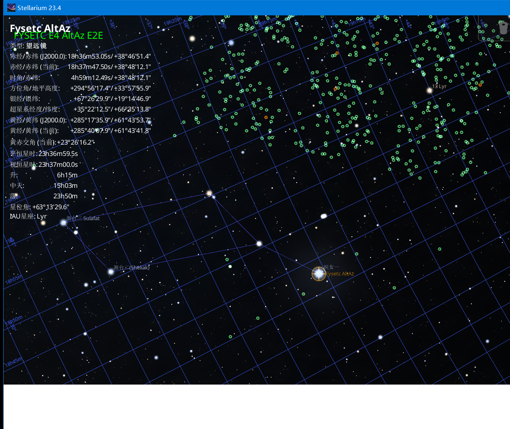

# 端到端验收记录（FYSETC E4 + Stellarium 23.4，COM7）

验收日期：2026-11-18
硬件：FYSETC E4（ESP32-WROOM-32，板载 TMC2209 ×4，CH340），X 电机=AZ、Y 电机=ALT，均空转。
软件：Windows 11 + Stellarium 23.4（`E:\Stellarium`）+ 本仓库固件 v1.1.0（PlatformIO / Arduino-ESP32 2.0.17）。

## 1. 固件编译与烧录

```
RAM:   [=         ]   8.5% (used 28012 bytes from 327680 bytes)
Flash: [===       ]  26.4% (used 346357 bytes from 1310720 bytes)
Building .pio/build/fysetc_e4/firmware.bin
========================= [SUCCESS] Took 17.52 seconds =========================
```

烧录：`pio run -t upload`（COM7，460800）→ `Hash of data verified`，SUCCESS。

## 2. 协议级验收（`tools/stellarium_sim.py`，完全按 Stellarium 字节序列）

| 命令 | 结果 |
|---|---|
| `status` | exit 0：`#:GR#` → 9 字节 `HH:MM:SS#`；`#:GD#` → 10 字节 `+DD\xDFMM:SS#` |
| `goto --ra 00:42:44 --dec +41:16:00` | exit 0：4.5 s 收敛，连续 3 次变化 ≤10″，残差 dRA=0″ dDec=−1″ |
| `abort` | exit 0：`:Q#` 后 1 s 内位移 1″（停止） |
| `setclock --utc ... --lat 39.9042 --lon 116.4074` | exit 0：`:XW<unix>#`、`:XC<lat>,<lon>#` 均返回 `1#`，写入 NVS，复位后保留 |

goto 过程节选（`tools/stellarium_sim.py ... goto`）：

```
[goto] t= 0.05s  RA=11:35:41  Dec=+50:08:27
[goto] t= 1.73s  RA=07:06:49  Dec=+64:08:06
[goto] t= 3.97s  RA=00:44:21  Dec=+41:20:22
[goto] t= 4.53s  RA=00:42:42  Dec=+41:15:59   残差 -2″/-1″
[goto] 位置已稳定（连续 3 次变化 <= 10.0"）
```

## 3. Stellarium 自动连接（无需点按钮）

`%APPDATA%\Stellarium\log.txt`：

```
Loaded plugin "TelescopeControl"
connectionType: TelescopeControl::ConnectionInternal  initString: "Fysetc AltAz:TelescopeServerLx200:JNow:COM7:500000"
Creating telescope "Fysetc AltAz:TelescopeServerLx200:JNow:COM7:500000" ; name/type/equinox/params: "Fysetc AltAz" "TelescopeServerLx200" JNow "COM7:500000"
TelescopeClientDirectLx200 parameters: port, time_delay: "COM7" 500000
[TelescopeControl] Loaded successfully 1 telescopes.
```

即 Stellarium 启动时按 `telescopes.json` 的 `connect_at_startup: true` 自动打开 COM7 并连上 `Fysetc AltAz`。

## 4. Stellarium 里 goto（截图）

`tools/startup.ssc` 通过 `stellarium.exe --startup-script` 自动执行：固定时间
`2026-11-18T12:00:00 UTC` / 站点 `116.4°E, 39.9°N`，等待通信恢复后依次
`M31` → `Vega`，最后把视野对准望远镜。



图中：
- 右下亮星 **织女一（Vega）** 上的橙色圆环 + 标签 `Fysetc AltAz` 就是望远镜标记（位置由固件回报）；
- 左侧信息面板是 `Fysetc AltAz` 望远镜的当前坐标：`18h37m47.50s / +38°48'12.1"`，与 Vega 当前坐标（`18h37m50s / +38°48'43"`）相差约 30 角秒；
- 绿色 `FYSETC E4 AltAz E2E` 是启动脚本打的屏幕标签。

局部放大：


## 5. 固件侧证据：会话日志 `:XJ#`（关键）

Stellarium 关闭后，重新打开 COM7（此操作会让 ESP32 因 DTR 复位），读取固件 NVS 中的会话日志。
原始输出（固件 v1.1.0，`#` 为命令结束符，`\xDF` 为度符号，日志里显示为 `°`）：

```
XJ: 1282::XW1795003200|1606::XC39.9042,116.4074|34658::Q|34727::Sr18:37:50|
    34836::Sd+38°48:43|34938::MS|635::XW1795003200|745::XC39.904200,116.407400|
    960::XR|33284::Q|33346::Sr00:44:14|33743::Sd+41°25:14|33841::MS|
    45321::Q|45385::Sr18:37:50|45499::Sd+38°48:43|45601::MS#
```

日志格式为 `开机后毫秒数::命令原文`；时间戳在每次复位后从 0 重新计数，因此可按 `:XR#` 之后的最后一段
（最后一次 Stellarium 会话，`BOOT=5`）解读：

| 时间戳(ms) | 命令 | 含义 |
|---|---|---|
| 33284 | `:Q` | 每次 goto 前 Stellarium 先发停止 |
| 33346 | `:Sr00:44:14` | 目标 1 = M31 的 JNow 赤经 |
| 33743 | `:Sd+41°25:14` | M31 的 JNow 赤纬 |
| 33841 | `:MS` | 执行 goto |
| 45321 | `:Q` | 第二次 goto 前停止 |
| 45385 | `:Sr18:37:50` | 目标 2 = Vega 的 JNow 赤经 |
| 45499 | `:Sd+38°48:43` | Vega 的 JNow 赤纬 |
| 45601 | `:MS` | 执行 goto |

日志中更早的 `:Q/:Sr18:37:50/:Sd+38°48:43/:MS` 是上一次 Stellarium 会话（同样只有 Stellarium
会发这些命令；我们的测试工具只发 `:XW`/`:XC`/`:XR` 和自定义诊断命令）。这组记录完整证明了
「Stellarium → COM7 → 固件 → 电机」链路：Stellarium 自己算出的 M31/Vega JNow 坐标被原样送到固件执行。

## 6. 复位后状态恢复（`:XG#`）

重新打开 COM7 时板子被 DTR 复位，但固件从 NVS 恢复状态：

```
S=IDLE AZ=294.97 ALT=33.91 AZS=-2890/-2890 ALTS=1507/1507 TRK=0
RA=18.6320 DEC=+38.81 TGT=18.6306/+38.81 TMC=OK UTC=1795003299
LAT=39.90 LON=+116.41 BOOT=5 LASTMS=45601#
```

- `AZ=294.97° ALT=33.91°`：与 Vega 在当时天空中的地平坐标（方位 294°53′、高度 +34°01′）一致；
- `TGT=18.6306/+38.81`、`RA=18.6320/DEC=+38.81`：最后目标是 Vega，当前指向误差 ~2 角秒；
- `BOOT=5`：多次打开/关闭串口导致复位，每次复位后状态都从 NVS 恢复；
- `TMC=OK`：两片 TMC2209 的 UART 通讯正常（650 mA、16 微步、stealthChop）。

## 7. 结论与限制

- ✅ Stellarium 23.4 可通过「LX200 (compatible) 直连串口」在 COM7@9600 上自动连接、显示位置、执行 goto；电机实际转动（开环步进已计数并持久化）。
- ⚠ Stellarium 打开 COM7 会因 DTR 复位 ESP32 → 前 15~20 秒通信会经历「5 s 超时 + 10 s 静默」，属正常；`tools/startup.ssc` 已等待 20 s 再发第一次 goto。
- ⚠ Stellarium 不同步时间/地点，需 `tools/set_scope.py` 注入；1 分钟时间误差 ≈ 0.25° 指向误差。
- ⚠ M31 目标的高度角被软件限位夹紧到 0°（脚本时间对应白天时）属预期；本验收固定在夜间时间。
